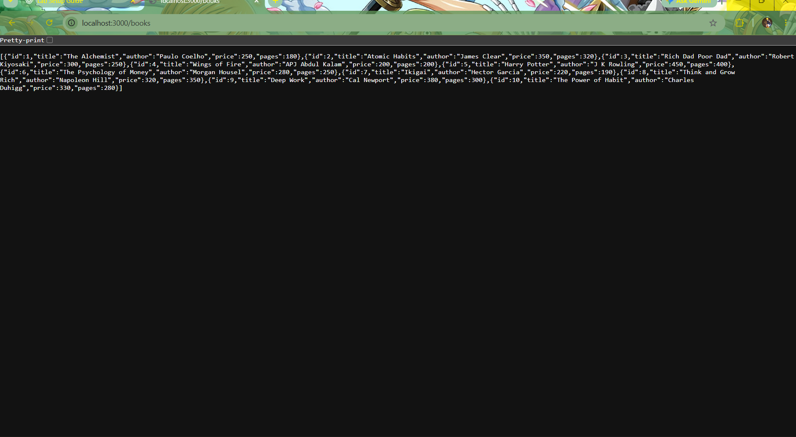
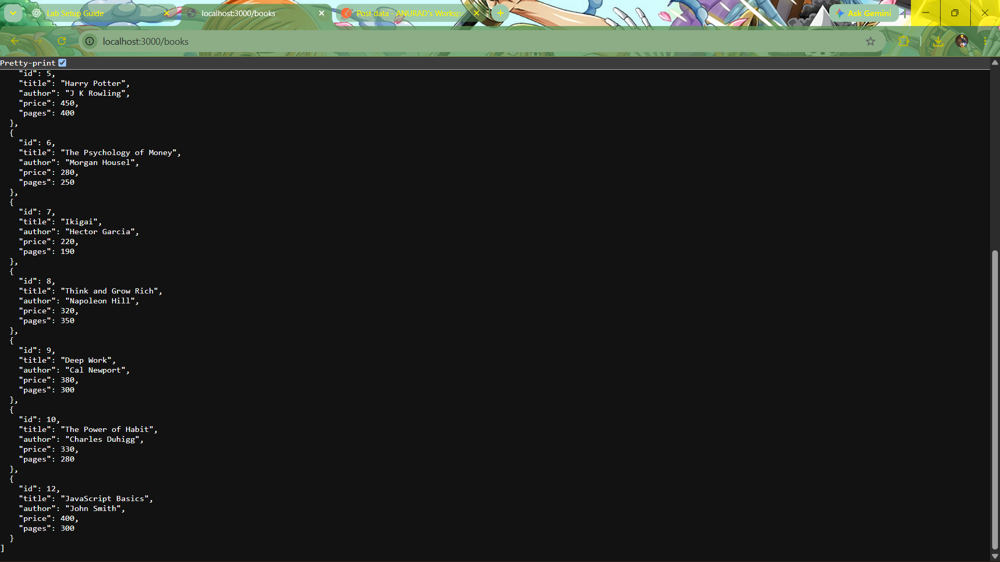

**Live Demo:** https://express-js-6hbe.onrender.com/
# Lab 02: Bookstore CRUD API with Express and SQLite

**Name:** ANURAD.P  
**Registration Number:** 252U1R1016  
**Section:** CSE CORE  

A RESTful API built using Node.js, Express, and SQLite (`sqlite3` and `sqlite` wrapper) to perform CRUD (Create, Read, Update, Delete) operations on a bookstore database.

## Project Structure

```text
lab-02/
│
├── app.js
├── db.js
├── package.json
├── .gitignore
├── README.md
│
├── bookStore.db
│
└── screenshots/
```

## Prerequisites

- [Node.js](https://nodejs.org/) (v16 or higher)
- npm

## Installation

1. Install dependencies:
   ```bash
   npm install
   ```

2. Start the server:
   - For standard start:
     ```bash
     npm start
     ```
   - For development mode with auto-reload:
     ```bash
     npm run dev
     ```

The server runs at: `http://localhost:3000/` by default. On hosting platforms such as Render, it uses the `PORT` environment variable provided by the platform.

## Database Schema

The database is stored in `bookStore.db` with a table named `book`:

| Column | Type | Constraints | Description |
|---|---|---|---|
| `id` | INTEGER | PRIMARY KEY AUTOINCREMENT | Unique book ID |
| `title` | TEXT | | Book title |
| `author` | TEXT | | Author name |
| `price` | INTEGER | | Price of the book |
| `pages` | INTEGER | | Number of pages |

## API Endpoints

### 1. Get All Books
- **Method:** `GET`
- **URL:** `/books/`
- **Response:** Array of all book objects

### 2. Get Single Book
- **Method:** `GET`
- **URL:** `/books/:bookId/`
- **Response:** Book object if found (`200 OK`), or `"Book Not Found"` (`404 Not Found`)

### 3. Add a Book
- **Method:** `POST`
- **URL:** `/books/`
- **Headers:** `Content-Type: application/json`
- **Body:**
  ```json
  {
    "title": "Clean Code",
    "author": "Robert C. Martin",
    "price": 450,
    "pages": 464
  }
  ```
- **Response:** `"Book Added Successfully"` (`201 Created`)

### 4. Update a Book
- **Method:** `PUT`
- **URL:** `/books/:bookId/`
- **Headers:** `Content-Type: application/json`
- **Body:**
  ```json
  {
    "title": "Clean Code (Updated)",
    "author": "Robert C. Martin",
    "price": 500,
    "pages": 464
  }
  ```
- **Response:** `"Book Updated Successfully"` (`200 OK`) or `"Book Not Found"` (`404 Not Found`)

### 5. Delete a Book
- **Method:** `DELETE`
- **URL:** `/books/:bookId/`
- **Response:** `"Book Deleted Successfully"` (`200 OK`) or `"Book Not Found"` (`404 Not Found`)

## Screenshots

### Get Books



### Add Book (POST)



### Update Book (PUT)


### Delete Book (DELETE)


